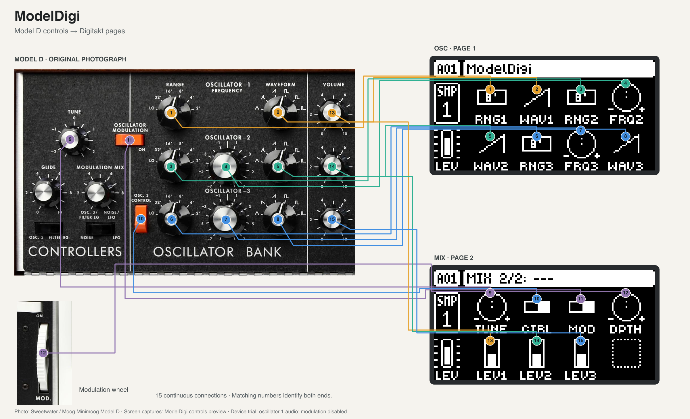

Instrument photograph: [Sweetwater](https://www.sweetwater.com/store/detail/MiniModelD--moog-minimoog-model-d-analog-synthesizer-appalachian-cherry). Digitakt screens: ModelDigi.

# ModelDigi

A Model D–style oscillator section for the **Digitakt mk1**.

## What works today

- Digitakt mk1 builds target **OS 1.54 only**. Digitone support is planned.
- All three oscillators play, with their ranges, waveforms, tuning, levels and
  sequenced notes, and oscillator 3 can modulate the pitch of the others.
- The waveforms and modulation match measurements of an original Model D's
  oscillators, and are checked against them on a computer.

ModelDigi currently supplies the oscillator section, rather than the complete
Model D filter, envelopes and amplifier.

## Playing ModelDigi

Select **ModelDigi** as a track's SRC machine. Press **SRC** to switch between
its two pages:

- **OSC:** oscillator ranges and waveforms, plus relative tuning for oscillators
  2 and 3.
- **MIX:** master tuning, oscillator levels, oscillator 3 control, and modulation
  on/off and depth.

Other tracks keep their own sounds.

MIDI CC 16–23 control OSC; CC 24–30 control MIX in page order. Selectors use
0–5, and other values use 0–127. See Development for the companion-version
requirement before testing saved sounds.

## CPU use

**ModelDigi is a CPU-heavy mod.** It generates its waveforms in real time and
smooths every waveform edge to reduce aliasing.
Pitch modulation, and especially many sharp edges at high pitches, add work.
This processing shares the Digitakt's CPU with its other tracks and effects.

The supported number of simultaneous ModelDigi tracks is still being
qualified.

Include [DigiHealth](https://github.com/irpina/digihealth#install) when
composing your firmware in Elekloader, and leave **SETTINGS → FAST AUDIO** ON:
ModelDigi's performance budget assumes it. FAST AUDIO runs the Digitakt's existing audio
code from faster memory to free up processing time.

## Firmware and documentation

ModelDigi is included in a custom OS composed with Elekloader using your own
stock Elektron OS file. See the [build and firmware guide](docs/development.md#build-steps)
for preparation instructions.

[Development and verification](docs/development.md) covers setup, mise tasks,
the code layout and testing. [Architecture](docs/architecture.md) explains the
engine and device integration. The [oscillator research](docs/model-d-oscillators.md)
documents the Model D behavior being modeled.

Code is GPL-2.0-or-later; see [LICENSE](LICENSE).
