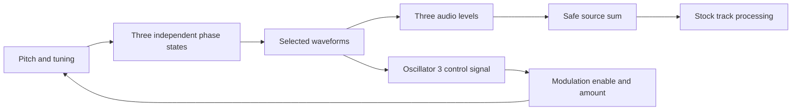

# Model D oscillator architecture and implementation basis

Research date: 2026-10-19. Scope: the oscillator section of the original
Minimoog Model D, delivered as a source for the host instrument's existing
track processing. This is research and a proposed implementation basis.

## Scope and recommended reference

Use the **CA3046-era original oscillator board** represented by the factory
old-board schematic, Figure 9-3, as the initial reference. This is a
recommendation, not a claim that every original Model D sounds identical.
Identify a reference instrument by its installed board and modifications,
not its cabinet serial alone: boards could be replaced.

Keep the early discrete board, later temperature-stabilized microA726 board,
and modern reissues separate. Support one calibrated model first, with no
user-facing revision selector. The relevant original-board distinction is
documented in the factory drawings [S2]; the component difference is also
consistent with the CA3046 and microA726 manufacturer descriptions [S5, S6].

Included: three oscillators, their waveform and range selectors, common
tuning, oscillator 2/3 relative tuning, oscillator 3 control switching and
pitch modulation, individual source levels, and a safe oscillator sum.
Source levels are the minimum needed to balance or silence three sources;
they do not imply modeling the complete analog mixer.

Excluded: Model D ladder filter, contour generators, VCA, noise generator
(including noise modulation), external audio/feedback, mixer saturation,
the A-440 generator, physical keyboard/glide circuitry, reissue LFO and
modulation additions, effects, hard sync, sub-oscillators, continuous PWM,
and a Digitone implementation. Host filter, amp, sequencer and LFO behavior
remain host behavior. Oscillator-only scope cannot reproduce complete
Model D patches that depend on the excluded circuits.

## Evidence and confidence

Source tags below distinguish manufacturer material from our engineering
choices. An archive hosts a source; it is not the author of the circuit.

| Tag | Source and inspected locations | Use and limits |
|---|---|---|
| S1 | Original *A Guide to the Operation of the Mini Moog Model D*, sections F-G, pp. 4-8; H, p. 9; PDF pp. 6-11 [download](https://www.midimanuals.com/manuals/moog/minimoog/operation_manual/moog_minimoog_operation_manual_rvgm.pdf) | Original control behavior. Scan includes July 1971 supplementary material; scan metadata is not the instrument's production date. |
| S2 | Factory *Service Manual for Minimoog Model 204D*, Figures 9-2/9-3 and 9-16/9-17; PDF pp. 4/5 and 18/19 [download](https://synthfool.com/docs/Moog/minimoog/Minimoog_Service_Manual.pdf) | Board and wiring evidence. This 46-page compilation contains drawings/parts, not a complete explanatory service text. |
| S3 | Factory service compilation, printed vi, 2-3 to 2-5, 2-9 to 2-10A; PDF pp. 6, 8-10, 14-16 [download](https://www.synthxl.com/wp-content/uploads/2018/02/Moog-Mini-moog.pdf) | Circuit explanations and revision comparison. 82-page scanned compilation; printed page labels are essential. |
| S4 | R. J. Folkman, *Technical Service Manual*, contents dated 7/73; section II, PDF p. 4; section XII, PDF p. 22 [download](https://www.synthxl.com/wp-content/uploads/2018/02/moog-minimoog-d-service-manual.pdf) | Original factory prose in a later digital transcription. Schematics are omitted; use S2 for drawings. |
| S5 | Harris CA3045/CA3046, November 1996, File 341.3 p. 5-24, reproduced on PDF p. 2 of Rochester's 2019 wrapper [download](https://datasheet.lcsc.com/datasheet/pdf/c23ff6d4efe00efa512bcdd75d5f99e7.pdf?productCode=C3196547) | Matched transistor array description, not measured properties of a vintage oscillator. |
| S6 | Fairchild, *microA726 Temperature-Controlled Differential Pair*, p. 68 / PDF p. 1 [download](https://radio-hobby.org/uploads/datasheet/7/ua72/ua726.pdf) | Actively regulated transistor-pair temperature explains why the later board is a separate reference. |
| S7 | Valimaki, Pekonen and Nam, JASA 131(1), 2012, pp. 974-986, especially sections II-IV, DOI 10.1121/1.3651227 [paper](https://mac.kaist.ac.kr/pubs/ValimakiPeknenNam-jasa2012.pdf) | Polynomial BLEP method; published results are not ModelDigi measurements. |
| S8 | Esqueda, Valimaki and Bilbao, *Rounding Corners with BLAMP*, DAFx-16, pp. 121-128, especially sections 2-4.1 [paper](https://www.dafx.de/paper-archive/2016/dafxpapers/18-DAFx-16_paper_33-PN.pdf) | Correction of derivative discontinuities, including triangles. |
| S9 | Timoney and Lazzarini, *Exponential Frequency Modulation Bandwidth Criterion for Virtual Analog Applications*, DAFx-11, sections 2-3 [paper](https://www.dafx.de/paper-archive/2011/Papers/60_e.pdf) | Pitch shift and bandwidth under exponential FM. The cosine-modulator bandwidth fit does not certify saw/pulse modulation. |

The nine downloaded PDFs have byte counts and full SHA-256 hashes in the
local source ledger under ignored research storage. Inspected renders and
working notes also remain there. No source PDFs, firmware, recordings or
third-party pictures belong in the reference branch.

**Verified from sources** means a manual statement or readable drawing.
**Derived** means our calculation from a stated model. **Proposed** means
an implementation decision. **Unmeasured** means no physical Model D or
ModelDigi device measurement was taken for this research.

## Original controls and waveform choices

The original owner's guide describes independent oscillators with range
positions LO, 32', 16', 8', 4', 2'. LO is a separate sub-audio range, not
another regular octave step. Oscillators 2 and 3 have relative-frequency
controls; oscillator 1 uses common tuning. Oscillator 3 can remain a
modulation source while inaudible. [S1, F-G and H]

| Selector position | Oscillators 1 and 2 | Oscillator 3 |
|---|---|---|
| 1 | Triangle | Triangle |
| 2 | Triangle/saw combination | Reverse saw |
| 3 | Saw | Saw |
| 4 | Square | Square |
| 5 | Intermediate rectangular pulse | Intermediate rectangular pulse |
| 6 | Narrow rectangular pulse | Narrow rectangular pulse |

This is discrete selection, not morphing. The original controls do not
offer PWM or hard sync. Three independently running phases are required;
the waveform choice changes the observation of a phase, not the phase
clock. The last sentence is a digital modeling consequence, not a measured
startup-phase specification. [S1, F; S4, II]

The guide describes oscillator 3's wider tuning sweep with control off,
and independent oscillator volume controls. It does not provide a signed,
quantitative waveform calibration. [S1, F and H]

The factory specification gives a combined oscillator range of 0.1 Hz to
20 kHz across overlapping ranges. Treat that as an instrument specification,
not a guarantee for every host MIDI note/range/modulation combination.
The supported digital domain and behavior beyond it must be explicit.
[S3, printed vi]

## Circuit anatomy and important consequences

The factory old-board explanation describes exponential current conversion,
a decreasing-ramp relaxation oscillator, transistor-derived triangle, and
a thresholded pulse. Wave selection supplies pulse bias and mixes saw and
triangle through resistors. It also states that OSC 3 CONTROL interrupts
keyboard, modulation, external-pitch and pitch-bend signals, while widening
oscillator 3 tuning. [S3, 2-10 and 2-10A]

Factory schematics identify the CA3046 conversion circuitry on the old
board and the microA726 circuitry on the later board. The drawing index
labels the latter for serials 10175 and above. [S2, Figures 9-2/9-3]
The CA3046 contains matched transistors on a common substrate; microA726
adds active temperature regulation. Neither datasheet supplies a musical
drift amount to put into software. [S5, p. 5-24; S6, p. 68]

The original service text calls the oscillators independent and
non-synchronous. It documents repairs to reduce unwanted oscillator bleed
and cross-modulation. Consequently, accidental coupling is not justification
for adding sync, random detuning or a generic analog-character control.
[S4, II and XII]

### Derived signal model

The minimum functional model is a pitch-summing stage followed by an
exponential frequency mapping, phase accumulation and waveform shaping:

```text
frequency_i = reference_i * 2^(range_i + common_tune + relative_tune_i
                              + keyboard_i + bend_i + external_i
                              + enabled_modulation_i)
phase_i += frequency_i / internal_sample_rate
```

Pitch terms in this expression are octaves. For a calibrated one-volt-per-
octave system, a semitone is 1/12 octave and a cent is 1/1200 octave. These
are mathematical units, not final device encodings. The five audio range
ratios relative to 8' are 1/4, 1/2, 1, 2 and 4. LO requires its own
calibration. Relative tuning is absent for oscillator 1. For oscillator 3
with CONTROL off, remove keyboard, bend, external pitch and incoming
modulation; retain its dedicated wide tuning path and applicable common
tuning. This routing follows the selected original circuit, not reissue
MIDI semantics. [S3, 2-10A; S2, Figure 9-3]



The modulation feedback to oscillator 3 is conditional on OSC 3 CONTROL.
Its waveform must be obtained before its audio-volume control. Do not
silence or freeze it merely because its audio level is zero.

**Derived:** symmetric exponential modulation changes average frequency.
For a zero-mean two-level modulator of depth `d` octaves, equally long
levels multiply average frequency by `(2^d + 2^-d)/2`; at `d = 1` this is
1.25, about 386.3 cents. Correcting that pitch shift automatically would
change the modeled behavior. S9 analyzes this issue for sinusoidal
modulation; the two-level example here follows directly from averaging.

### Polarity, loading and DC

Choose a signed phase convention and document each shape against the
selected drawing. Compare the two saw directions explicitly. Magnitude
spectra cannot establish their signs, and an output-path inversion cannot
locate an oscillator-level inversion.

For the triangle/saw combination, derive the passive network with its
source and load impedances. Do not implement an arbitrary 50:50 blend.
Likewise retain relative waveform levels instead of independently
normalizing every waveform's RMS.

Audio and modulation are different observation paths. Determine coupling,
offsets and inversion independently. A pulse's audio DC removal must not
silently redefine its modulation voltage. At LO, an audio high-pass can
turn a slow waveform into clicks; that does not prove the oscillator phase
or modulation waveform is wrong. Moog's [support note](https://moogmusic-help.freshdesk.com/en/support/solutions/articles/69000840857-moog-minimoog-model-d-why-is-my-model-d-making-a-clicking-sound-)
also identifies audible LO clicks as expected behavior.

## Frozen calibration basis

[Calibration version 1](oscillator-calibration.md) resolves the initial
implementation basis: signed normalized shape/level and pulse tables, loaded
triangle/saw mixture, normal/wide tuning, LO observations, modulation offsets
and conditional feedback means. Its portable numeric bundle freezes observable
reference targets and explicit engineering approximations. It does not claim
unique internal voltages, physical-unit qualification or an exact continuous
wheel law. Raw low-note/LO audio shape remains excluded; common-path harmonic
ratios provide a separately validated static comparison.

The actual shared C core is the next implementation. Its concrete interface
requires approval before application; device controls and saved identity remain
later gates. No second oscillator model is needed.

The factory specification sheet itself contains an apparent oscillator-number
typo for reverse saw; the original owner's guide and dedicated oscillator 3
inverter drawing agree. Do not copy the isolated specification line as a
behavioral requirement. [S3, printed vi; S1, F; S2, Figure 9-3]

## Recommended digital implementation

Start with a compact behavioral model, not a per-sample transistor solver.
Exercise the actual shared C engine through a standalone host renderer, with
independent analytic checks and reviewed recorded measurements. For static
shapes, additive harmonic series can check the bandlimiting mathematics.
For modulation, check numerical convergence of the same C algorithm as its
internal rate increases; convergence alone does not establish circuit fidelity.
Do not maintain a second oscillator implementation as a substitute for the
recordings. Bounded fixed-point rendering is an engineering recommendation
for ColdFire, not evidence that an implementation meets its CPU budget.

1. Keep three phase states and correction history per machine instance.
   Advance phases through notes, waveform changes and source muting. Note
   events update pitch/gate ownership; they do not synchronize the VCOs.
   A 32-bit phase at 48 kHz has an increment resolution of about 11.18
   microhertz, sufficient to investigate the stated LO range without a
   separate low-frequency oscillator algorithm. This calculation does not
   bound errors in tuning conversion or modulation arithmetic.
2. Use a shared phase definition for the saw-derived shapes, with measured
   or circuit-derived shaping coefficients. Correct waveform jumps with
   BLEP and derivative jumps with BLAMP. S7 describes polynomial step
   correction; S8 covers slope correction, including triangle synthesis.
3. Calculate oscillator 3 modulation at audio/internal sample rate.
   Evaluate the complete feedback system against a converged oversampled
   reference. Do not claim that static oscillator antialiasing also
   suppresses all modulation sidebands. S9's cosine-specific bandwidth fit
   is not a general saw/pulse-FM guarantee.
4. Select the smallest fixed oversampling factor, if any, that passes the
   reviewed quality matrix and the target timing budget. Do not add a
   user quality selector or adaptive framework in advance of evidence.
5. Preserve internal headroom using sufficiently wide accumulators and
   explicit scaling. Review bounds before narrowing to output Q31.
   Silence and invalid inputs must never create wraparound, NaNs or an
   unbounded loop. No allocation, I/O or waiting in audio callbacks.
6. Use one conservative output gain that preserves relative source levels.
   Proposed initial maximum peak: -6 dBFS across the agreed matrix,
   including transitions and bandlimiting overshoot. This is a headroom
   policy to review, not a Model D voltage specification. Avoid auto-gain
   based on the number of enabled oscillators and avoid routine clipping.

OB-1 has useful fixed-point event-correction and test patterns. Its current
engine is a two-VCO instrument with sub-octaves, hard sync, its own XMOD
depth, source calibration, DC treatment and a 12 kHz increment limit.
Reusing that complete voice would import unrelated behavior and restrict
this model. Reuse only isolated, understood math with independent checks;
do not change OB-1 or extract a shared library in this project.

## Host integration and approval boundaries

Source inspection of the pinned SDK establishes a 32-sample Q31 render
event after track playback and before stock overdrive. The emulator/device
configuration is 48 kHz. Machine-pages 1.2 permits fifteen logical source
values over two pages; the extra values use its version-4 sound handling.
This is an SDK contract, not permission to revise its schema.

Proposed control inventory: three waveform selectors, three ranges, three
audio levels (zero mutes), oscillator 2/3 relative frequency, common tune,
OSC 3 CONTROL, modulation depth and modulation enable: **15 values**.
This inventory fits the existing companion without a new persisted format.
It is not a final page layout or approved set of parameter encodings.
Combining level and mute is a deliberate device adaptation; separate
remembered on/off switches would require another control-scope decision.

Before assigning slots/defaults, changing the shared DSP API, choosing a
permanent machine ID or publishing sounds, present the concrete contract
and obtain approval as AGENTS.md requires. Include centered tuning
resolution, LO units, discrete selector treatment under LFOs/locks, MIDI
mapping, cold defaults and save/reload behavior. Master tune is per machine
instance here, not a request to change global instrument tuning.

Keep all device parameter decoding, note arbitration, pitch conversion,
voice lifetime and UI in the wrapper. Initially consume the host's note
and pitch behavior. Low-note priority, glide and a physical Model D's
keyboard are separate controller features, not necessary oscillator DSP.
Preserve stock non-ModelDigi tracks. Leave the Digitone scaffold untouched.

## Verification and delivery gates

| Boundary | Required evidence |
|---|---|
| Circuit/reference | Identified board, signed waveform records, transfer derivations and explicit uncertainties. A physical reference is desirable; circuit simulation alone remains simulation evidence. |
| Host mechanics | Frequencies, all selectors/ranges, pulse duty/polarity, relative levels, DC paths, continuous phase, block-splitting equivalence, extreme inputs, overflow and buffer guards. |
| Audio quality | Coherent spectral comparison against additive/oversampled reference; complex harmonics where phase matters; low and high pitches; narrow pulses; shape/range/level transitions. Proposed gates: pitch error at most 1 cent in the agreed unmodulated domain and static in-band alias residual at most -60 dBc over a stated practical pitch grid. Freeze exact analysis/window/band definitions before accepting results. |
| Modulation | Tracking on/off, muted oscillator 3, all modulation shapes, low/audio rates, depth extremes, mean-pitch shift over complete modulation periods, self-modulation when connected, bounded feedback and convergence as the same C algorithm's internal rate increases. Distinguish cents of mean frequency from time-averaged pitch in cents. State the supported domain; do not weaken a failed gate silently. |
| Firmware | Build/lint/package Digitakt OS1.54; compiled note/control dispatch, blank-to-configured cold start, locks/LFOs, machine switching, unrelated-track isolation and save/reload. |
| Timing | Compare matched stock/scaffold and candidate firmware with two realistic ModelDigi instances, including other host activity. Record maximum render cost/jitter, not only average or host speed. No promised instance capacity before measurement. |
| Physical device | After separately authorized installation, manual panel setup plus read-only USB verification by default; exact-build controls, levels, note behavior and persistence. Emulator success is not hardware qualification or analog-fidelity proof. |

Keep regression expectations independent of the production implementation.
Distinguish numerical mechanics, reference-model agreement, firmware
integration, physical-device behavior and agreement with a particular
analog unit. End-to-end filtered recordings cannot uniquely identify raw
oscillator shape or polarity.

An audio output before a filter or amplifier can still be AC-coupled. Turning
off a downstream DC blocker does not bypass source coupling. Screen the
observation path before treating LO shape, DC, pulse duty or relative levels
as core properties. Short multi-oscillator spectra also depend on beating and
starting phase; use within-path ratios or appropriately averaged comparisons.

Waveform fits must preserve the expected polarity and use fractional phase
alignment. Record interpolation, window and normalization with extracted
harmonics. Modulation span must be accompanied by a mean-pitch measurement;
centered plots alone can conceal a duty-dependent offset. An integrity hash
baseline records the files at the time it is established, and must not be
presented as proof of earlier capture-time integrity.

The implementation sequence and dependency graph belong in GitHub issues.
This document records durable source findings and design rationale. The initial normalized calibration and observation targets are frozen in
version 1, with exclusions and approximations stated separately. Shared DSP
interfaces, device controls, sound identity and persisted meanings retain
their explicit approval gates.
